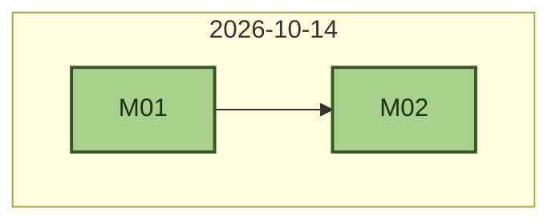

# План-сессий: abap_bench_internal

> Каждая сессия — самодостаточный модуль для автономного агента-исполнителя.
> Формат файла сессии (`docs/sessions/<ID>_session.md`, шаблон — `_template.md`):
> шапка (Этап | Владелец | Зависимости | Оценка | Статус) → ⚠️ Прочитай → Правила исполнителя →
> Предусловия → Задачи (с ✅ Самопроверками) → Критерии приёмки → Ловушки → Отчёт.
> **Приоритет источников при конфликте:** `PLAN.md` → `docs/adr/` → сессии → `backlog/`.
> Строки таблицы без файла — этапы дорожной карты (PLAN.md §11); файл сессии
> создаётся из `_template.md` при старте сессии.

## Текущее состояние

> Обновляется при закрытии сессии (clock-out — `AGENTS.md`); проверка — `make check`.
> Закрытые ✅-строки таблицы переносятся в [sessions-archive.md](sessions-archive.md) (`make session-archive`).
> Раздел — **только живое состояние** (последняя ✅, WIP, очередь, baseline): пересказы
> закрытых сессий — в их файлах и архиве; решения владельца — в ADR. Не дублировать.

- Последняя ✅: M02 — ZCL_AI_TASKS + ZAI_IMPORT_TASKS (парсер §4.1, upsert/version, MD5-хэш; импорт — M07)
- В работе (WIP): —
- Очередь: M → M03 (LLM-клиент + MOCK); батч фазы 1 — [ADR-006](adr/ADR-006-phases-offline.md)
- Baseline: `make check` зелёный на `main` — 2026-10-14 (харнесс — [ADR-001](adr/ADR-001-agent-harness.md); abaplint-гейт — [ADR-002](adr/ADR-002-abaplint-gate.md); NW 7.54 — [ADR-003](adr/ADR-003-nw-754.md); имена `Z*AI_*` — ADR-004; SDK/прокси — ADR-005; фазы/офлайн — ADR-006; пакет `ZAI` — ADR-007)

## История

## Владельцы треков

| Трек | Владелец | Зона |
|---|---|---|
| **M** | владелец | SAP-реализация — этапы M1–M5 (PLAN.md §11): DDIC, движок, отчёты, фаза 2 |
| **T** | владелец | датасет задач: `tasks/`, `tools/build_tasks.py` |
| **P** | владелец | план и решения: `PLAN.md`, `docs/adr/` |

## Структура сессий

Формат строки: `| <ID> | [<файл>](sessions/<ID>_session.md) | <этап одной строкой> | <владелец> | <зависимости> | <оценка, дни> | <P0–P3> | <статус> |`.
ID — буква трека + две цифры (`[A-Z]\d{2}`); файл сессии — `docs/sessions/<ID>_session.md`.

| # | Файл | Этап | Владелец | Зависимости | Оценка | Приоритет | Статус |
|---|------|------|----------|-------------|--------|-----------|--------|
| M03 | [M03_session.md](sessions/M03_session.md) | Ф1: ZIF_AI_LLM_CLIENT + ZCL_AI_LLM_MOCK + ZCX_AI_LLM | владелец | M01 | — | P0 | ⬜ |
| M04 | [M04_session.md](sessions/M04_session.md) | Ф1: ZCL_AI_CANON + ZCL_AI_CHECK | владелец | M01 | — | P0 | ⬜ |
| M05 | [M05_session.md](sessions/M05_session.md) | Ф1: ZCL_AI_SETT + ZCL_AI_ENGINE (цикл S/X/I, resume, ENQUEUE) | владелец | M02, M03, M04 | — | P0 | ⬜ |
| M06 | [M06_session.md](sessions/M06_session.md) | Ф1: ZAI_RUN (ручной запуск) + ZAI_STATUS (логи, ALV) | владелец | M05 | — | P0 | ⬜ |
| M07 | [M07_session.md](sessions/M07_session.md) | Ф1: деплой в систему (пакет ZAI) + приёмка сквозным прогоном на MOCK | владелец | M06 | — | P1 | ⬜ |
| M08 | — | Ф2: BL-1 (SDK) + ZCL_AI_LLM_SDK_PROXY + реестр реальных моделей + первый реальный прогон | владелец | M07 | — | P1 | ⬜ |
| M09 | — | Ф2: ZAI_REPORT (тренды/алерты/CSV) + планировщик ZAI_SCHEDULE_JOB (+транзакционные коды §13.2) | владелец | M08 | — | P1 | ⬜ |
| M10 | — | Ф3: юнит-тесты — Z_AI_RUN_TESTS, ZCL_AI_ASSERT, EXECUTE_UNIT_TESTS (PLAN.md §7) | владелец | M07 | — | P2 | ⬜ |

Легенда статусов: ⬜ не начата · ◐ в работе · ✅ завершена (+дата ГГГГ-ММ-ДД).

Закрытые сессии (✅) — в [sessions-archive.md](sessions-archive.md); в таблице выше — только живой план.

## Правила параллельной работы

1. Зона трека — «Владельцы треков» выше; общие файлы (`PLAN.md`, `AGENTS.md`) — только через согласование с владельцем.
2. **WIP=1**: не более одной ◐ на трек — машинный гейт (`make check`, скрипт `check_sessions.py`).
3. Статусы сессий обновляются в таблице этой страницы: ⬜ → ◐ → ✅ (+дата ГГГГ-ММ-ДД); блок «Текущее состояние» — при каждом clock-out. Закрытые ✅-строки переносятся в [sessions-archive.md](sessions-archive.md) (`make session-archive`).
4. Стык треков — только через зафиксированные контракты (`PLAN.md`/ADR); изменение контракта = ADR + синхронная правка `PLAN.md`.
